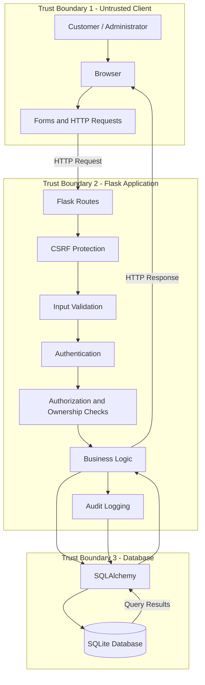

# SecureShop - Data Flow Diagram

## 1. Application Architecture

SecureShop follows a Flask application architecture.

The main data flow is:

Browser -> Flask Routes -> Security Checks -> Business Logic
-> SQLAlchemy -> SQLite Database.

## 2. Data Flow Diagram

## 3. Trust Boundaries

### Boundary 1: Browser to Flask

The browser is not trusted.

All submitted information must be validated by the server.

### Boundary 2: Application Security Layers

Authentication identifies the user.

Authorization determines whether that user can perform
the requested action.

Input validation checks submitted information before
business logic processes it.

### Boundary 3: Flask Application to Database

SQLAlchemy handles database operations.

Database operations must use safe ORM or parameterized
queries.

Sensitive information must be protected.

## 4. Data States

- Data in transit: Requests and responses between browser
  and Flask.
- Data in use: Information processed by Flask routes
  and business logic.
- Data at rest: Records stored in the SQLite database.

## 5. Security Checkpoints

1. CSRF validation.
2. Server-side input validation.
3. Authentication.
4. Administrator authorization.
5. Customer ownership verification.
6. Safe database operations.
7. Security event logging.

## 6. Review Status

This diagram represents the initial architecture.

Mark and Youssef must review the final data flows,
database operations and trust boundaries against
their actual implementations.
