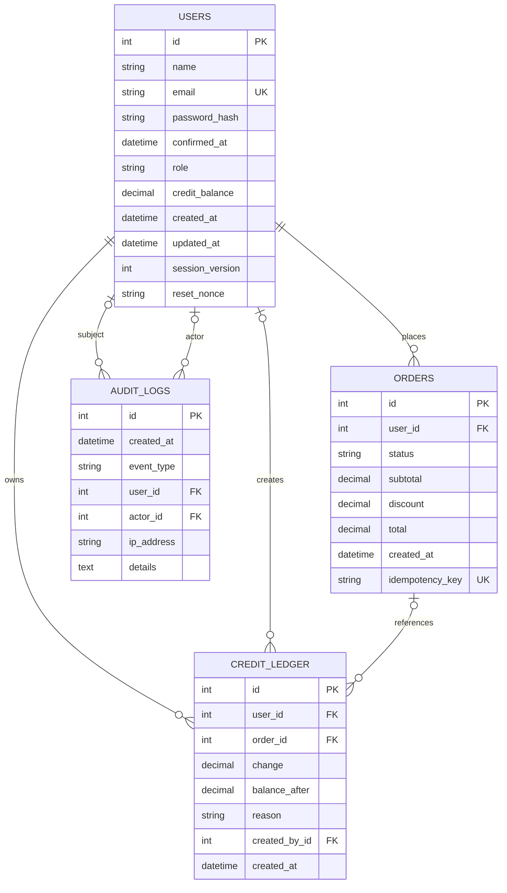

# SecureShop – Database Entity Relationship Diagram

## 1. Introduction

This document describes the current database structure of SecureShop, a Flask-based e-commerce application.

The database currently contains four implemented tables:

1. users
2. orders
3. credit_ledger
4. audit_logs

The diagram is based on the SQLAlchemy models and Alembic migration files.

## 2. Entity Relationship Diagram

## 3. Table Relationships

| Relationship | Description |
|---|---|
| Users – Orders | One user can place multiple orders. |
| Users – Credit Ledger | One user can have multiple credit transactions. |
| Users – Credit Ledger (created_by_id) | An administrator may create multiple credit adjustments. |
| Orders – Credit Ledger | A credit transaction may reference an order. |
| Users – Audit Logs (user_id) | An audit event may identify an affected user. |
| Users – Audit Logs (actor_id) | An audit event may identify the user who performed an action. |

## 4. Primary and Foreign Keys

- Every table has an integer primary key named `id`.
- `orders.user_id` references `users.id`.
- `credit_ledger.user_id` references `users.id`.
- `credit_ledger.order_id` references `orders.id`.
- `credit_ledger.created_by_id` references `users.id`.
- `audit_logs.user_id` references `users.id`.
- `audit_logs.actor_id` references `users.id`.

The nullable foreign keys allow audit events and administrative credit adjustments to exist without all associated user or order references.

## 5. Database Integrity

The database uses:

- Primary key constraints.
- Foreign key constraints.
- Unique email indexing.
- Unique order idempotency keys.
- Non-negative user credit balance.
- Non-negative order subtotal, discount and total.
- Discount cannot exceed subtotal.
- Non-negative recorded credit balance after transactions.

## 6. Implementation Status

The diagram represents the current registered SQLAlchemy models and migration structure.

Product, coupon, newsletter subscriber and order-item tables are not included because they are not present in the inspected current model definitions.

The diagram must be updated when additional database models are integrated.